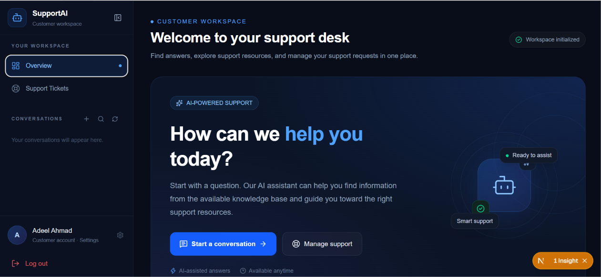
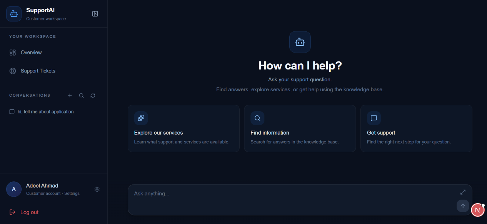
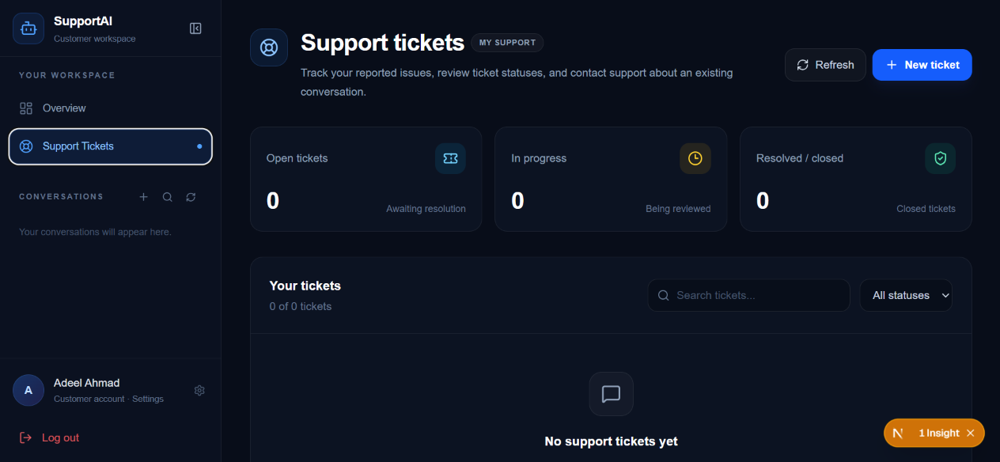
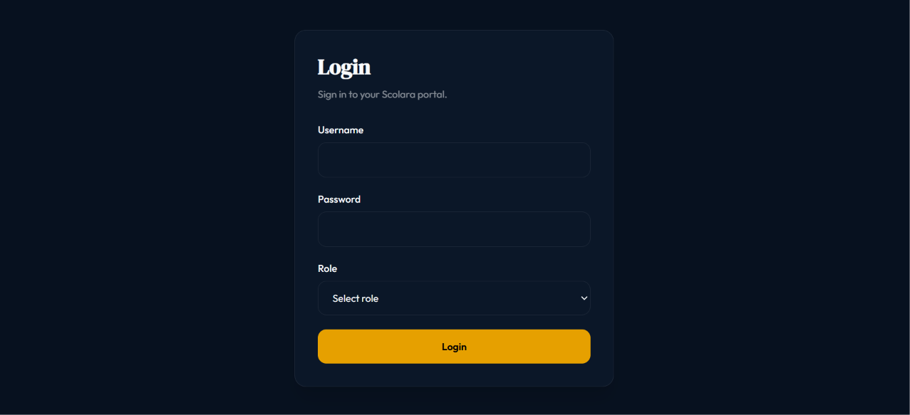
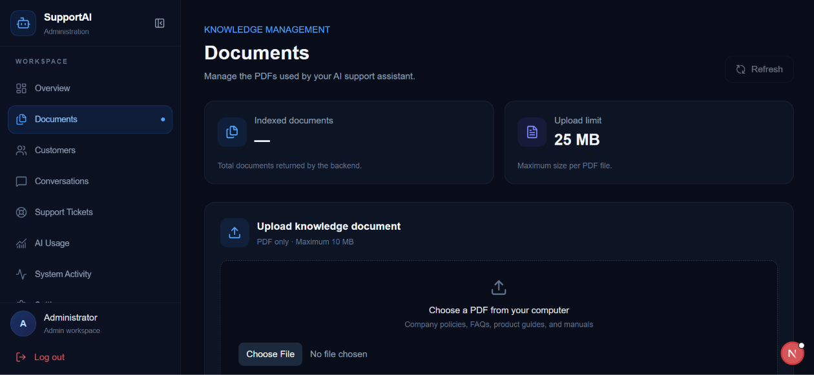

# 🤖 Support AI

### Intelligent Customer Support. Powered by AI.

An AI-powered customer support application that uses Retrieval-Augmented Generation (RAG) to provide context-aware answers from business knowledge and documentation.

 

 

**[🌍 View Live Demo](https://ssupport-ai.vercel.app)**

---

## 📖 About the Project

**Support AI** is an AI-powered customer support application designed to help businesses provide intelligent and context-aware responses to customer queries.

Traditional customer support systems often require users to search through lengthy documentation or wait for human support representatives.

Support AI addresses this problem by combining Large Language Models (LLMs) with Retrieval-Augmented Generation (RAG).

The application retrieves relevant information from a knowledge base and uses that context to generate helpful responses.

Instead of relying entirely on a language model's general knowledge, the system grounds its answers in relevant business information.

## ✨ Key Features

- 🤖 **AI-Powered Conversations** — Generate intelligent responses to customer questions.
- 🧠 **Retrieval-Augmented Generation (RAG)** — Retrieve relevant knowledge before generating answers.
- 📚 **Knowledge-Based Responses** — Use business documentation as a source of information.
- 🔍 **Semantic Search** — Find relevant information based on the meaning of a query.
- 💬 **Interactive Chat Interface** — Communicate with the AI through a conversational interface.
- 🔐 **User Authentication** — Secure user access and authentication.
- 🗄️ **Persistent Database** — Store application data using PostgreSQL.
- ⚡ **FastAPI Backend** — Handle API requests and AI processing.
- 🧩 **LLM Integration** — Integrate Google's Gemini models for response generation.

## 🧠 How It Works

Support AI follows a Retrieval-Augmented Generation workflow.

1. **Knowledge Input** — Business information and documentation are provided to the system.
2. **Document Processing** — Content is prepared for retrieval.
3. **Embedding Generation** — Text is converted into vector representations.
4. **Knowledge Retrieval** — Relevant information is retrieved based on the user's query.
5. **Context Construction** — Retrieved information is provided as context to the language model.
6. **Response Generation** — Gemini generates a context-aware response.
7. **Answer Delivery** — The generated response is returned through the chat interface.

## 🖥️ Screenshots

| User Dashboard | Chat Interface |
|:---:|:---:|
|  |  |

| Support Tickets | Authentication |
|:---:|:---:|
|  |  |

| Knowledge Base | Admin Dashboard |
|:---:|:---:|
|  |  |

## 🛠️ Technology Stack

| Technology | Purpose |
|---|---|
| Next.js | Frontend application |
| React.js | Component-based user interface |
| TypeScript | Type-safe frontend development |
| Tailwind CSS | Interface styling |
| Python | Backend development |
| FastAPI | Backend API framework |
| Pydantic | Data validation and schemas |
| Google Gemini | Large Language Model integration |
| RAG | Knowledge-grounded response generation |
| Embeddings | Semantic representation of text |
| PostgreSQL | Relational database |
| Neon | Serverless PostgreSQL hosting |
| SQLAlchemy | Database ORM |
| OAuth | Authentication integration |

## 🚀 Live Demo

The project was deployed using Vercel.

<text></text>

**Live Website:** https://ssupport-ai.vercel.app

## 🎯 Project Objectives

- Build an intelligent customer support solution.
- Apply Retrieval-Augmented Generation in a practical application.
- Connect Large Language Models with external knowledge sources.
- Generate context-aware responses instead of relying only on general LLM knowledge.
- Develop a scalable full-stack AI application.
- Integrate authentication and persistent data storage.
- Gain practical experience in AI engineering and RAG systems.

## 📚 What I Learned

Through this project, I gained practical experience in:

- Building full-stack applications with Next.js and FastAPI.
- Integrating Large Language Models into real applications.
- Understanding and implementing RAG workflows.
- Working with embeddings and semantic retrieval.
- Connecting AI applications with PostgreSQL.
- Managing database operations using SQLAlchemy.
- Integrating OAuth authentication.
- Designing APIs using FastAPI and Pydantic.
- Connecting frontend interfaces with AI-powered backend services.

## 🔮 Future Improvements

- Multi-document knowledge base management.
- Improved document processing and retrieval.
- Conversation history and chat management.
- Source references for generated answers.
- Human support handoff.
- Analytics and customer support insights.
- Advanced retrieval strategies and reranking.
- Multi-tenant support for different businesses.
- More advanced AI agents and automated workflows.

## 👨‍💻 Developer

**Saqlain Ahmad**

Full Stack Software Engineer & AI Engineer

- GitHub: [@saqlainhub](https://github.com/saqlainhub)

---

### 🤖 Thanks for checking out sSupport!

If you like this project, consider giving it a ⭐ on GitHub.

**Making Customer Support Smarter with AI.**

